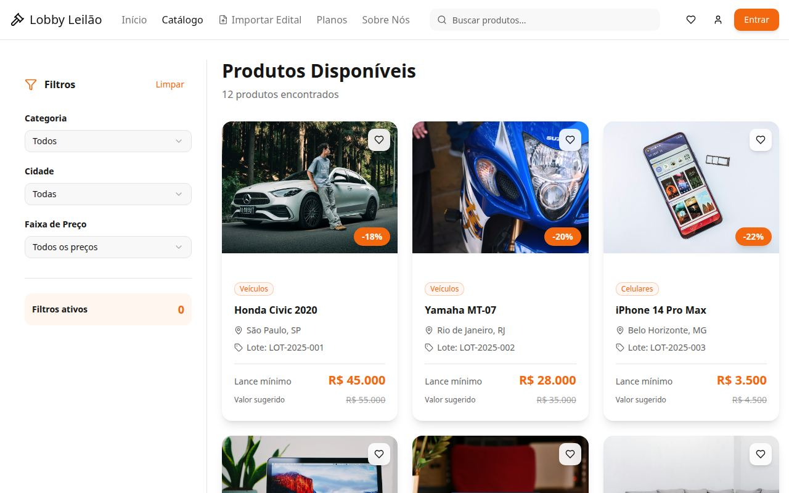
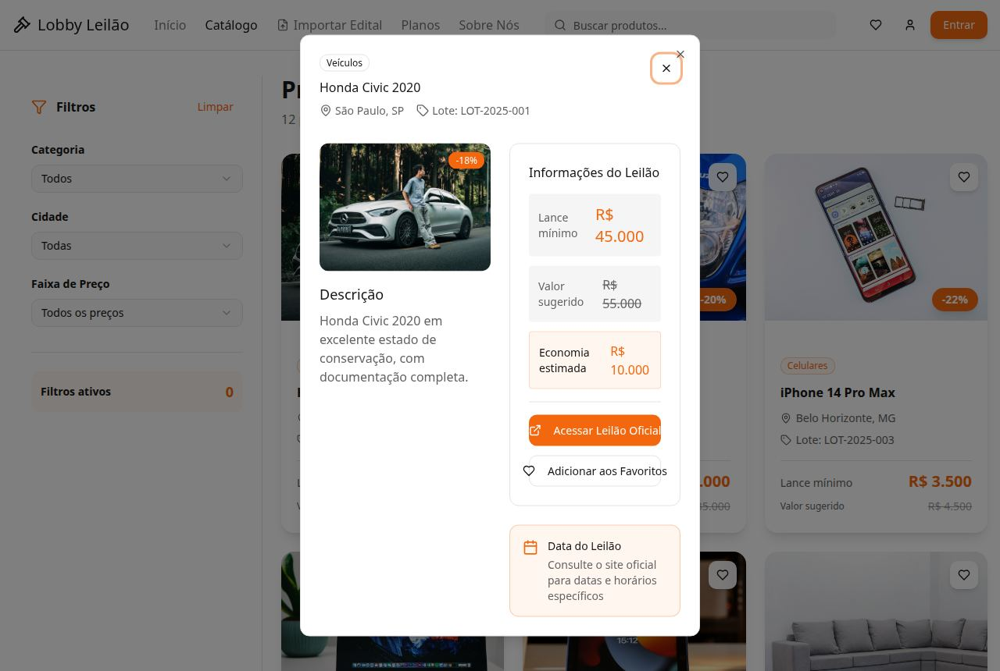
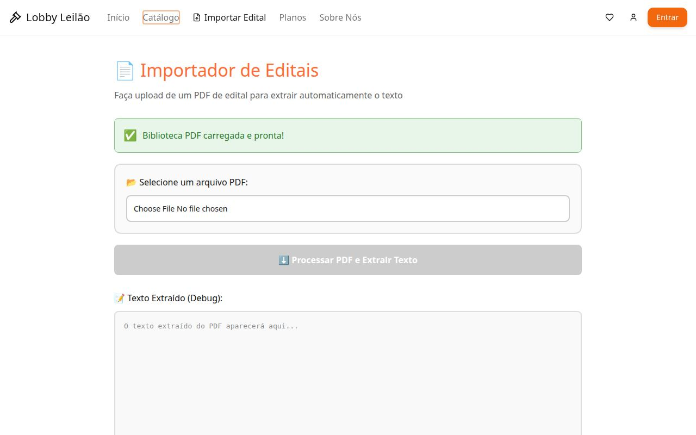

# Lobby Leilão

Plataforma para achar produtos de leilão sem abrir edital em PDF. A pessoa busca por produto, categoria ou cidade, filtra o catálogo, abre o detalhe de um item e importa editais para transformar o documento em uma lista navegável.

Interface em React, TypeScript e Vite, desenhada no Figma. Os produtos de exemplo estão em dados locais e o importador lê PDF no navegador.

Não há demo publicada. O endereço que constava aqui não existe mais na Vercel: a resposta é 404 com `DEPLOYMENT_NOT_FOUND`. As imagens abaixo são do projeto rodando localmente.

## Telas








## Como rodar

```bash
npm install
npm run dev
```

O servidor de desenvolvimento abre em `http://localhost:3000`.

Para gerar os arquivos estáticos e conferir o resultado do build:

```bash
npm run build
npx vite preview
```

O build não depende de variável de ambiente.

## Publicar na Vercel

Crie um projeto novo e importe este repositório. O `vercel.json` já fixa o que o preset da Vercel precisa:

- Framework: Vite
- Build Command: `npm run build`
- Output Directory: `dist` (o preset da Vercel procura essa pasta; antes o Vite gravava em `build`)

Início, Catálogo, Importar, Planos e Sobre são estado da interface, não rotas da URL. O rewrite envia qualquer caminho sem arquivo para `index.html`.

Quando o deploy estiver no ar, use a URL nova (`https://<nome-do-projeto>.vercel.app`) em dois lugares: o campo Website do About deste repositório no GitHub e o parágrafo da demo neste README.
